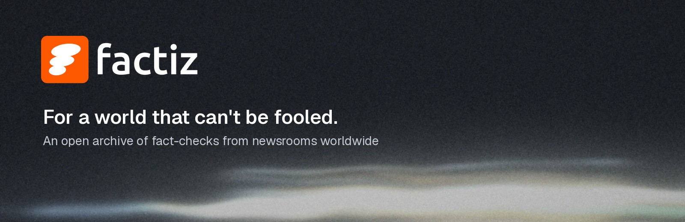
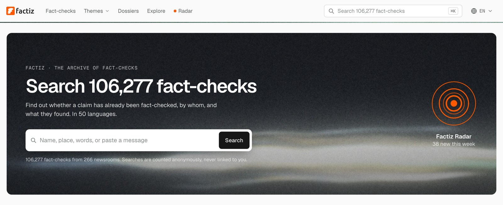
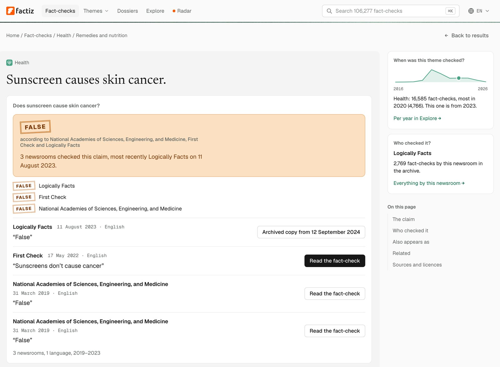

<h1 align="center"><a href="https://factiz.org"></a></h1>

<p align="center">
  <a href="https://factiz.org"><b>factiz.org</b></a> &nbsp;·&nbsp;
  <a href="docs/PROTOCOL.md">Resolver protocol</a> &nbsp;·&nbsp;
  <a href="CONTRIBUTING.md">Contributing</a> &nbsp;·&nbsp;
  <a href="https://github.com/factiz-org/factiz/issues?q=is%3Aissue+is%3Aopen+label%3A%22good+first+issue%22">Good first issues</a> &nbsp;·&nbsp;
  <a href="https://github.com/factiz-org/factiz/discussions">Discussions</a> &nbsp;·&nbsp;
  <a href="README.nl.md">Nederlands</a>
</p>

<p align="center">
  
  
  
  
</p>

[factiz.org](https://factiz.org) is an open archive of fact-checks. Each page is one claim: the newsrooms that checked
it, what they found, and a link to their article. We never decide what is true ourselves. The verdict belongs to the
newsroom that did the work, and we show it with their name on it.

| 106,277 | 109,074 | 266 | 49 | 15 |
|:-:|:-:|:-:|:-:|:-:|
| claims | fact-checks | newsrooms | languages of the claims | languages of the site |

<sub>The edition of 23 November 2026. 829 of those claims were checked by two or more newsrooms.</sub>

<table>
  <tr>
    <td width="50%" valign="top"><a href="https://factiz.org"></a></td>
    <td width="50%" valign="top"><a href="https://factiz.org/fact-checks/780a2a56fecb094e/"></a></td>
  </tr>
  <tr>
    <td valign="top"><sub>Search the archive in any of 15 languages, or paste a message you were sent.</sub></td>
    <td valign="top"><sub>One claim, three newsrooms. Each verdict stays in the newsroom's own words, with a link to its article.</sub></td>
  </tr>
</table>

This repository is everything behind it: the lab that builds the archive every week, the site that serves it, our own
fact-checks, and the resolver protocol that lets any tool ask the same question we do.

## Why this exists

Most false claims are not new. The claim that Google Maps removed Palestine was debunked in 2020 and came back in
2024, in three languages, while the first debunk sat in an archive nobody searched. Nobody did anything wrong. The
checks just could not find each other.

Factiz connects them. It reads open fact-check data, recognises the same claim across wording and languages, and
puts every newsroom that checked it on one page. Where newsrooms disagree, both verdicts stay visible.

## What is in here

| folder | what it is |
|---|---|
| `doublecheck/` | the lab, in Python: imports the feeds, matches claims across languages, runs every measurement, and builds the weekly edition, one SQLite file with only what may be published |
| `factiz_site/` | the platform in Python, the reference for every endpoint under `/api/<language>/` |
| `site/` | the site in Astro, with the platform rewritten in TypeScript (`site/src/platform/`); runs as a Cloudflare Worker on D1, and must answer exactly what the Python platform answers (`python -m factiz_site.gelijk`) |
| `content/` | what people write: our own fact-checks (Factiz Radar), dossiers, themes, the weekly world list |
| `docs/PROTOCOL.md` | the resolver protocol, a draft standard, in English |
| `conformance/` | a runnable test that checks any resolver against the protocol |
| `tests/` | about 9,500 test cases; they build their own small databases and need no lab |

Factiz Radar is our own fact-checking. The checks are drafted with Claude, an AI model, and say so on the page
("Claude (AI)"); a human editor who did not write a check reads it before it goes live. What is still unknown is published
as unknown, with a request for help.

## The resolver layer

Behind the archive sits a smaller idea that can stand on its own. Give a resolver an artifact from the wild (a piece of
text, a screenshot, or only the fingerprint of an image) and it answers whether that claim was checked before, by whom,
and with what verdict. `GET /.well-known/doublecheck` describes what a resolver can do, and `POST /resolve` asks the
question.

The resolver keeps fingerprints, never artifacts. An image can stay on the user's device, because the resolver also accepts
its 256-bit PDQ hash. Logging of artifact content is off at the library level. And there is no truth percentage anywhere in the
protocol: the answer is "checked by X and Y" or "we have no check for this", never "73% true".

The protocol is written to be implemented by others, and implementing it needs no permission (`LICENSE-PROTOCOL.md`).

## Running it

You need Python 3.12 (not the 3.9 that ships with macOS), Node 22, and Tesseract for reading text in images.

```bash
python3.12 -m venv .venv && source .venv/bin/activate
pip install -r requirements.txt
npm ci --prefix site                     # the TypeScript platform; the tests use it too
brew install tesseract tesseract-lang    # the base formula only reads English
pytest -m "not nli"                      # the suite, without the slow model tests
uvicorn doublecheck.api:app --reload     # the resolver on :8000
python -m conformance http://localhost:8000
```

On a fresh checkout without the lab's data, with the site's packages installed (the line with `npm ci` above), all
9,595 cases that run there passed on 24 November 2026.

The site needs an edition to read:

```bash
npm ci --prefix site && npm --prefix site run build
FACTIZ_PUBLICATIE=path/to/publicatie.db npm --prefix site start    # http://localhost:8796
```

There is no small sample edition in the repository yet, so for now the site only runs against an edition you built
yourself, and that takes the lab: first the corpus (`python -m doublecheck.bootstrap --plan` says what it will cost
before it starts), then `python -m doublecheck.publiceren bouwen`. We have not tried that path on a clean machine.
A sample edition is the first open task (see below). `CLAUDE.md` lists every command the lab has.

## Where the fact-checks come from

| source | what we take | licence |
|---|---|---|
| the ClaimReview feed of Data Commons | claim, verdict, newsroom, date, link | CC BY 4.0 |
| the EUvsDisinfo database | the case and its disproof | the reuse rules of the EEAS |
| Factiz Radar and the world list | our own work, with a link to every source | CC BY 4.0, see `content/LICENSE.md` |

We link to every newsroom's own article and never copy it. Fact-checks we read on newsroom sites ourselves stay out
of every edition until that newsroom says yes; the lab only uses them for measurement. The edition never contains
anything a visitor sent us.

## Measured, including the misses

Every number we publish has a run behind it in `docs/BENCHMARK.md`, with date and configuration. Runs that later turned
out to be wrong stay in, with the reason, because a benchmark in which nothing ever went wrong is not a benchmark.

There are no ads on the site. Our own counts are anonymous and added up per day: no IP address, no cookie. Until a
visitor says yes to Google Analytics, their browser loads nothing from any other domain.

## Licences

| piece | licence |
|---|---|
| the code and documentation | AGPL-3.0, see `LICENSE`: who runs a changed version as a service shares the changes |
| the protocol, `docs/PROTOCOL.md` | CC BY 4.0, see `LICENSE-PROTOCOL.md`; implementing it is unrestricted |
| our own writing in `content/`: Factiz Radar, dossiers, the world list | CC BY 4.0, see `content/LICENSE.md` |
| the conformance test, `conformance/` | MIT, see `conformance/LICENSE` |
| the claim "conformant to the resolver protocol" | free, on one condition: the test passes. See `TRADEMARK.md` |
| fact-checks by other newsrooms | their own licence, as listed above |
| screenshots of posts in `factiz_site/static/redactie/` | the rights of whoever posted them; we show them as quotations |
| the Noto fonts in `factiz_site/fonts/` | SIL Open Font License |

The codebase and the protocol carry the technical name `doublecheck`; Factiz is the name of the service. `TRADEMARK.md`
explains how the two relate.

## Working with us

There is a lot to do, and much of it does not need the whole lab. A sample edition so the site runs anywhere, checks
that run on every pull request, a second reader for the translations in your language, a newsroom we are missing:
`docs/GOOD-FIRST-ISSUES.md` lists tasks that stand on their own.

Start with `CONTRIBUTING.md`. Sign off every commit with `git commit -s` (the Developer Certificate of Origin); there is
no agreement to sign beyond that. The project documents are in Dutch, the working language of the team; `docs/README.md`
explains them in English and translates the words you will meet in the code. Issues and pull requests are welcome in
English or Dutch, and questions go to [Discussions](https://github.com/factiz-org/factiz/discussions).

Found a security problem? Do not open an issue. `SECURITY.md` says where to write.

Factiz is built in the Netherlands by [Ideelab](https://ideelab.nl/). The archive is free and non-commercial.
