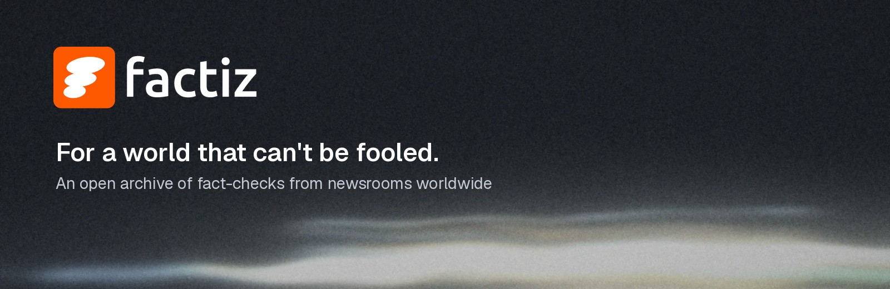

<h1 align="center"><a href="https://factiz.org"></a></h1>

<p align="center">
  <a href="https://factiz.org"><b>factiz.org</b></a> &nbsp;·&nbsp;
  <a href="docs/PROTOCOL.md">Resolverprotocol</a> &nbsp;·&nbsp;
  <a href="CONTRIBUTING.md">Meedoen</a> &nbsp;·&nbsp;
  <a href="https://github.com/factiz-org/factiz/discussions">Discussions</a> &nbsp;·&nbsp;
  <a href="README.md">English</a>
</p>

[factiz.org](https://factiz.org) is een open archief van factchecks. Elke pagina is één bewering: de redacties die haar
controleerden, wat ze vonden en een link naar hun artikel. Wat waar is, beslissen we nooit zelf. Het oordeel is van de
redactie die het werk deed, en we tonen het met haar naam erbij.

De uitgave van 23 november 2026 telt 106.277 beweringen en 109.074 factchecks van 266 redacties. De beweringen staan
in 49 talen, de site is te lezen in 15. 829 beweringen zijn door twee of meer redacties gecontroleerd.

In dit repo staat alles wat erachter zit: het lab dat het archief elke week bouwt, de site die het toont, onze eigen
factchecks en het resolverprotocol, waarmee elk ander hulpmiddel dezelfde vraag kan stellen als wij. De Engelse
editie van dit bestand is de voordeur: [README.md](README.md).

## Waarom

De meeste onware beweringen zijn niet nieuw. Dat Google Maps Palestina zou hebben weggehaald, werd in 2020
weerlegd en kwam in 2024 terug, in drie talen, terwijl de eerste factcheck in een archief stond waar niemand zocht.
Niemand deed iets fout. De checks konden elkaar alleen niet vinden. Factiz herkent dezelfde bewering in andere woorden
en andere talen, en zet elke redactie die haar controleerde op één pagina.

## Wat erin staat

- `doublecheck/`: het lab in Python. Leest de factchecks in, koppelt beweringen over talen heen, doet elke meting en
  bouwt elke week de uitgave: één SQLite-bestand met alleen wat gepubliceerd mag worden.
- `factiz_site/` en `site/`: het platform in Python (de maatstaf) en de site in Astro met het platform in TypeScript,
  als Cloudflare Worker op D1. Beide geven op elke ingang hetzelfde antwoord (`python -m factiz_site.gelijk`).
- `content/`: wat mensen schrijven, zoals onze eigen factchecks (Factiz Radar) en de dossiers. Elke eigen check is
  geschreven met Claude (AI), staat zo op de pagina, en is voor publicatie nagelezen door een redacteur die hem niet
  schreef.
- `docs/PROTOCOL.md` en `conformance/`: het resolverprotocol (een concept, in het Engels) en de toets die elke resolver
  ertegen houdt. De resolver bewaart vingerafdrukken, nooit het artefact zelf, en geeft nooit een waarheidspercentage.

## Draaien

Python 3.12 (niet de 3.9 van macOS), Tesseract voor tekst in beelden, Node 22 voor de site:

```bash
python3.12 -m venv .venv && source .venv/bin/activate
pip install -r requirements.txt
brew install tesseract tesseract-lang
pytest -m "not nli"
uvicorn doublecheck.api:app --reload
```

Een kleine voorbeelduitgave om de site zonder het lab te draaien, staat nog niet in het repo; dat is de eerste open
taak. `CLAUDE.md` noemt elk commando van het lab.

## Licenties

De code en de documentatie vallen onder **AGPL-3.0** (`LICENSE`), het protocol onder **CC BY 4.0**
(`LICENSE-PROTOCOL.md`), ons eigen werk in `content/` (Factiz Radar, de dossiers, de wereldlijst) ook onder **CC BY 4.0**
(`content/LICENSE.md`), de conformantietoets onder **MIT** (`conformance/LICENSE`). Jezelf conform noemen mag als de
toets slaagt (`TRADEMARK.md`). Factchecks van andere redacties houden hun eigen licentie: de feed van Data Commons
is CC BY 4.0, EUvsDisinfo valt onder de regels van de EEAS.

## Meedoen

Lees `CONTRIBUTING.md`; `docs/GOOD-FIRST-ISSUES.md` noemt taken die op zichzelf staan. Issues en pull requests zijn
welkom in het Nederlands en het Engels. Een beveiligingsprobleem meld je zoals `SECURITY.md` zegt,
buiten de issues om.

Factiz wordt in Nederland gebouwd door [Ideelab](https://ideelab.nl/). Het archief is gratis en niet-commercieel.
